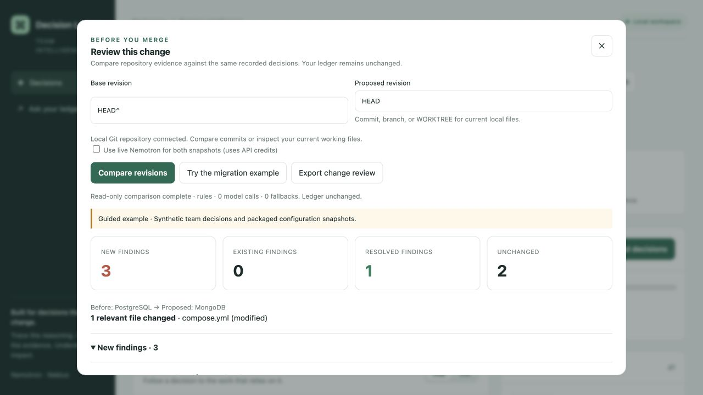

# Decision Ledger

**Catch the assumptions your migration forgot to update.** Decision Ledger checks recorded engineering decisions against repository evidence, traces affected work and owners, and preserves human review history.

Built for the Nebius x NVIDIA Global AI Hackathon using **NVIDIA Nemotron through Nebius Token Factory**. The current verified model is `nvidia/Nemotron-3.5-Super-VL`, used for all three configurable routing roles (extraction, linking and judging). Role names Nano/Super/Ultra do not imply three distinct tested models.

The local app records and imports decisions, checks repository evidence, traces dependency impact, and records resolutions. Read-only before-and-after Git comparison is implemented, including a bundled migration example. Automatic GitHub PR integration is not implemented. See [measured results and limitations](docs/RESULTS.md) and [setup and submission steps](docs/FINISH_AND_SUBMIT.md).



## The problem

Teams make decisions in Slack, tickets and PRs, then forget them. Months later the code has moved on, the decision is quietly wrong, and everything built on top of it is at risk. Search can find the old message. It cannot tell you it is no longer true.

The primary demonstration is a synthetic database migration: configuration changes to MongoDB while reporting assumptions still rely on PostgreSQL. The roadmap/commitment domain is an additional fixture, not a validated customer use case.

## What it does

1. **Extracts** decisions from Slack, GitHub, Jira and Notion/Drive into one small claim schema (Nemotron Nano), and links them with `depends_on`, `supersedes` and `contradicts` edges (Nemotron Super).
2. **Finds suspicious claims cheaply** with graph queries: conflicting claims on one subject, and load-bearing claims with many dependents.
3. **Verifies** each candidate against reality: dependency manifests in the repo (read-only, optionally in an OpenShell/NemoClaw sandbox), a roadmap for customer commitments, and Tavily for external signals such as deprecation.
4. **Judges** with Nemotron Ultra over the small subgraph plus evidence, returning a verdict with citations. A deterministic rule fallback keeps it working offline and is the eval baseline.
5. **Propagates**: anything depending on a failed decision is flagged for review, and the UI shows the red spreading along the dependency edges.
6. **Answers** "why did we decide X, and is it still true?" with citations, warnings about conflicts and staleness, and permission-aware retrieval (retrieval respects the supplied access groups).
7. **Prepares follow-up**: the UI creates local issue drafts. CLI publishing and sweep commands are implemented; scheduled Nebius hosting and external Slack/GitHub publication have not been demonstrated. They require separate configuration and authorization.

Why a graph: impact propagation, supersession chains and structural conflict detection keep the expensive model off most of the data.

## Deploy a judge demo

[Deploy on Render](https://render.com/deploy?repo=https://github.com/harsharajkumar-273/decision-ledger) using the included Blueprint. Enter your Nebius key and a separate demo sign-in password privately in Render. See [deployment instructions](deploy/render.md), including free-instance sleep and disposable-state limits. This configuration has not yet been deployed.

## Quickstart (no API key needed)

```bash
pip install -e ".[dev]"
pytest

dledger check data/sample/graph.json --repo data/sample/repo --no-llm
dledger ask   data/sample/graph.json why do we use postgres --no-llm
dledger serve data/sample/graph.json --repo data/sample/repo    # http://127.0.0.1:8000
dledger eval                                              # strategy comparison
```

In the sample, the Postgres decision (d1) is **contradicted** because the repo moved to MongoDB, the later MongoDB decision (d5) is **valid**, and the decisions that depended on Postgres (d3, d4) are flagged `needs_review`. In the UI, press **Run check** and watch it spread.

The sample includes an explicit application configuration snapshot, `data/sample/repo/runtime.json`.
This is fixture evidence, not live deployment discovery. To verify your own settings, provide
`runtime.json` at the repo root with a `technologies` object mapping claim subjects to selected values:

```json
{"technologies": {"database": "mongodb", "queue": "celery", "cache": "redis"}}
```

An explicit setting takes precedence over leftover dependencies. Without a setting, an installed
library provides supporting evidence, while a missing library returns **needs review**: it may be
used remotely or by another service. A valid verdict means the gathered evidence supports the
claim, not that production behavior has been audited. Keep snapshots current; deployment discovery
is not implemented. The UI reports actual model calls, token usage, latency, and rules fallback.

The workspace includes a readable dependency map, a searchable decision list with status filters,
and an inspector for reasoning, evidence and downstream impact. Use **Export report** after a check
to save the complete JSON result. The latest check is restored on browser refresh. With `DLEDGER_PERSIST=1`,
verification history and evidence also survive server restarts. Reset clears the
current report while preserving historical snapshots.

Second domain, same engine (customer commitments):

```bash
DLEDGER_AS_OF=2026-10-08 dledger check data/commitments/graph.json --repo data/commitments --no-llm
```

## With Nemotron on Nebius Token Factory

```bash
cp .env.example .env     # NEBIUS_API_KEY and the Nemotron model ids from the Token Factory catalog

dledger connect slack ./slack-export --out messages.jsonl      # or jira / notion / github owner/repo
dledger ingest messages.jsonl --out graph.json                 # --domain commitments for sales/support data
dledger check graph.json --repo ./my-repo --web                # --web adds Tavily
dledger eval-models --tiers nano,super,ultra                   # accuracy and cost per tier
```

| Step | Tier | Why |
|---|---|---|
| Extraction | Nemotron Nano | High volume, cheap |
| Linking, dedup, Q&A | Nemotron Super | Needs cross-claim context |
| Verdicts | Nemotron Ultra | Only for graph-selected candidates |
| Retrieval (optional) | NVIDIA embedding model | Set `DLEDGER_MODEL_EMBED` |

Per-tier token counts and latency are tracked in `dledger.llm.USAGE` and exposed at `/api/usage`.

## Evaluation

**1. Strategy comparison** (`dledger eval`, synthetic scenarios with explicit application configuration snapshots, deterministic verifier, so differences come from the strategy):

```
strategy        verifs  cost  stale_P stale_R stale_F1  dep_R
full_sweep        1486  100%    1.00    1.00     1.00   1.00
graph_guided       851   57%    1.00    0.80     0.89   1.00
random_budget      851   57%    1.00    0.65     0.79   0.72
```

Graph-guided selection verifies 57% as many claims as a full sweep and finds more stale decisions than a random subset of the same size. It misses *silent drift*: the code changed and the decision has neither a competing claim nor dependents. The nightly full sweep exists to close that gap. The scenarios are synthetic and the dependents figure is favorable by construction, so read this as evidence for the mechanism, not a real-world accuracy claim.

**2. Per-tier model accuracy** (`dledger eval-models`): hand-labeled seed sets in `data/eval/` (22 messages for extraction, 12 evidence-to-verdict cases for judging, and 6 linking scenarios). It reports precision/recall and verdict accuracy next to token and latency cost for Nano, Super and Ultra. The sets are small by design and meant to be extended; results from real model runs belong in `docs/SUBMISSION.md`.

## Components

| Path | What |
|---|---|
| `src/dledger/graph.py` | Claim graph, conflicts, impact, supersession |
| `src/dledger/extract.py`, `domains.py` | Nemotron extraction and linking, per-domain prompts |
| `src/dledger/verify.py`, `webcheck.py` | Repo, roadmap and Tavily evidence |
| `src/dledger/sandbox.py` | Isolated verifier subprocess with a scrubbed environment |
| `src/dledger/judge.py`, `pipeline.py` | Verdicts and propagation |
| `src/dledger/ask.py` | Hybrid retrieval, warnings, permission filtering |
| `src/dledger/connectors/` | Slack export, Jira, GitHub, Notion/Drive |
| `src/dledger/server.py`, `ui/` | API, web UI, Slack slash command |
| `src/dledger/actions.py` | Slack summary, GitHub issues |
| `deploy/nebius.md`, `Dockerfile` | Serverless Endpoint and Job |
| `docs/` | Architecture, demo script, submission text |

## Limits, stated plainly

- Verifiers cover dependency choices and dated commitments. Other kinds of claims return "needs review" rather than a guess.
- Value-to-package matching uses an alias table (`verify.ALIASES`); extend it for your stack.
- The Slack connector reads workspace exports. Live Slack and Jira API polling is not implemented.
- Sandboxing is a documented command hook (`DLEDGER_SANDBOX_CMD`); the OpenShell wrapper syntax depends on your install.
- The model ids and Token Factory base URL are configured, not hard-coded. Copy them from the Nebius console.

## Feedback on Nebius and NVIDIA tools

See `docs/FEEDBACK.md`.

## License

MIT

## Repository changes and audited resolutions

Use **Watch repository** to monitor relevant source, manifest and configuration files
and Git HEAD every five seconds. A change triggers a full verification sweep, including
silent drift. The report records changed paths and the commit; file contents and
credentials are not included in watch notifications. Watched files are limited to
5,000 files of at most 1 MB each. The ledger itself is excluded to avoid feedback loops.

Database verification now reads native `.env` database URLs, Compose images and
literal Python engine/client calls. It never executes repository code. Conflicting
or unresolved environments produce review rather than a guessed production state.
Explicit scope and conditional decisions are preserved by ingestion; unmet or
unverifiable conditions stay uncertain. Native configuration takes precedence over
the legacy `runtime.json` snapshot. Static settings do not prove production behavior.

Failed decisions generate local issue drafts with evidence, affected work and owners.
The inspector can record an existing decision as a replacement or a human confirmation
of a decision needing review. Each action records the reviewer, explanation and time.
Superseding an old assumption does not clear dependent work automatically. Rechecks
cannot revive superseded decisions. Set `DLEDGER_PERSIST=1` to save status and audit
history to the graph file; otherwise they remain in this server process.

```bash
python scripts/demo.py init /tmp/dledger-demo
DLEDGER_PERSIST=1 dledger serve /tmp/dledger-demo/ledger.json --repo /tmp/dledger-demo
# Enable Watch repository in the UI, then in another terminal:
python scripts/demo.py migrate /tmp/dledger-demo
```

Read [the three-minute demo](docs/WINNING_DEMO.md), [collected results](docs/RESULTS.md),
and [the real user-study protocol](docs/USER_VALIDATION.md).

```bash
dledger doctor --live --out docs/results/model-readiness.json
dledger eval-models --task all --out docs/results/models.json
dledger benchmark --out docs/results/adversarial.json
dledger benchmark --models --out docs/results/model-comparison.json
```

Live evaluation never silently substitutes rules for unavailable models. Extraction,
linking and judging have separate labeled sets. The live RAG and graph judges use the
same configured model so tier differences do not confound that comparison. Their
prompts, context and guardrails differ, so this is a system comparison rather than a
pure graph ablation. The published local results are synthetic; live-model results,
external user feedback and Nebius deployment remain unverified until actually run.

## Verification history and review ownership

The **Review queue** keeps failed decisions and unresolved dependent work visible,
even after their original prerequisite is superseded. Filter by owner and select
a task to inspect its evidence and changed prerequisites.

The **Verification timeline** records checks, resolutions and resets with before/after
statuses. Select an event to inspect its read-only evidence snapshot or export it.
Historical views never replace the current graph or enable actions on old state.
Selective checks retain earlier evidence for decisions they do not reverify.

With `DLEDGER_PERSIST=1`, history is saved in `<graph path>.history.sqlite3`. Set
`DLEDGER_STATE` to choose another database path. Without persistence, history stays
in memory for that server session. The same graph and database must be retained
for restart recovery; if the graph was edited externally, the previous report is
kept in history but is not presented as the current state. Watch mode must be
enabled again after a server restart.

For a demo stored in the project rather than a temporary directory:

```bash
python scripts/demo.py init .local/demo
DLEDGER_PERSIST=1 dledger serve .local/demo/ledger.json --repo .local/demo
python scripts/demo.py migrate .local/demo
```

See [history and recovery](docs/HISTORY.md) for the data lifecycle.

### Record decisions in the workspace

Use **Record decision** to capture a choice, subject, value, owner and reasoning. Optional prerequisites connect it to the existing graph; flagged prerequisites immediately put the new entry in the review queue. Superseded prerequisites cannot be selected. New entries are unchecked, never automatically supported.

Choose **Verify this decision** in the inspector to collect evidence for a single entry. Creation and verification have separate timeline snapshots. With `DLEDGER_PERSIST=1`, decisions and history survive server restarts; without it they last for the server session. The owner is a supplied attribution, not an authenticated identity.

API: `POST /api/decisions` accepts `text`, `subject`, `value`, `owner`, `reason`, optional `kind` (`tech_choice`, `commitment`, `policy`), `scope`, `source`, `condition`, ISO `date`, and `dependencies` (existing decision IDs). `POST /api/check` accepts `ids` for a targeted check, mutually exclusive with `full: true`.

### Import existing architecture decision records

Choose **Import ADRs**, paste Markdown and select **Preview decisions**. Each top-level `#` heading starts a record; `## Decision` supplies the choice and `## Context` or `## Rationale` supplies its reasoning. `Owner:`, `Subject:`, `Value:`, `Scope:` and `Condition:` metadata are optional; provide a default owner or fill missing fields in the preview. The built-in example demonstrates two records.

The parser uses local Markdown rules with no model calls. It suggests a subject and value only when the Decision section names one recognized technology. Ambiguous or incomplete records and non-accepted document statuses start unselected. Review the fields and select the records you want to save. These suggestions are not semantic validation: wording such as negation, alternatives or dependencies still needs human review. No relationships are inferred.

Imports preserve the supplied source label and starting line, save one timeline snapshot per batch, and leave entries unchecked. Identical text, subject, value and scope (ignoring case and surrounding whitespace) are skipped, including duplicates within the same batch. An invalid entry rejects the whole batch. Limits: 100,000 pasted characters, 20 records per preview/save. Imported claims can then be verified individually in the inspector.

API: `POST /api/import/preview` accepts `{text, source, owner}` and returns editable candidates without changing the ledger. `POST /api/import` accepts `{decisions: [...]}` using the same fields as decision creation, and returns `created_decision_ids` and `skipped_duplicates` alongside the report.

### Finish the project and submit

Follow [the end-to-end runbook](docs/FINISH_AND_SUBMIT.md) for local setup, real Nebius access, model import and batch verification, evaluations, user testing, hosting and the final submission. Run `.venv/bin/python scripts/prepare_submission.py` to collect local checks, or add `--live` after configuring credentials to opt in to paid model evaluations.

The workspace now shows evidence coverage and a list of decisions without recorded assessments. **Check unchecked decisions** checks those entries without rechecking previously assessed decisions. After saving an import, **Check imported decisions** checks the newly created entries as a batch. **What needs to change** summarizes failed/retired assumptions, unresolved dependents, owners and evidence. Coverage records whether a decision has been assessed, not whether it is supported.

In **Import ADRs**, opt into **Use Nemotron extraction through Nebius** to preview actual model suggestions. They remain unselected until reviewed. The preview reports its model and token count; unavailable model access fails explicitly without silently using Markdown rules. Configure all routing roles and use the CLI ingestion workflow for model-based dependency linking. Live extraction, linking and judging evaluations are recorded in docs/RESULTS.md; a public hosted deployment and actual user study remain outstanding.

## Review a proposed change

Select **Review this change** and compare local Git commits or branches, or use `WORKTREE` for current working files. The report separates new, existing, resolved and unchanged findings, with before/after evidence, affected owners and dependency paths. **Try the migration example** works without Git using a packaged synthetic fixture. Comparisons are read-only; model calls are optional and disclosed. See [change-review behavior and limits](docs/CHANGE_REVIEW.md).

### Faster onboarding and review briefs

Import existing Markdown ADR files in a batch, review extracted choices and owners, and save only approved candidates. Every source filename and line is retained. Change comparisons now lead with a concise evidence-backed brief and affected owners; full before/after findings are available on demand. See [the workflow guide](docs/CHANGE_REVIEW.md).
