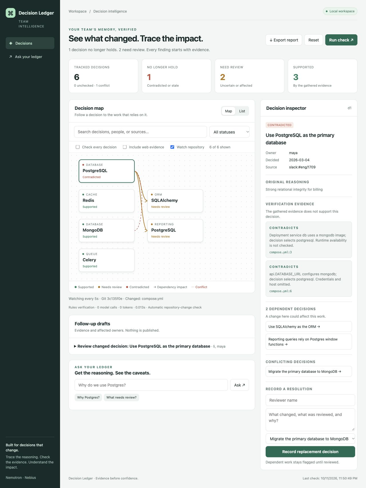

# Decision Ledger

**Catch the assumptions your migration forgot to update.** Decision Ledger checks recorded engineering decisions against repository evidence, traces affected work and owners, and preserves human review history.

Built for the Nebius x NVIDIA Global AI Hackathon using **NVIDIA Nemotron through Nebius Token Factory**. The current verified model is `nvidia/Nemotron-3.5-Super-VL`, used for all three configurable routing roles (extraction, linking and judging). Role names Nano/Super/Ultra do not imply three distinct tested models.

The local app records and imports decisions, checks repository evidence, traces dependency impact, and records resolutions. A Git base-versus-proposed-change comparison and GitHub PR review integration are not implemented. See [measured results and limitations](docs/RESULTS.md).



## Where Nemotron fits

Rules decide what the repository says; Nemotron handles what rules cannot: **extracting decisions from messy Slack/Jira/Notion text** (F1 0.93 to 1.0 on our labeled set), **linking** them into a dependency graph, and **judging ambiguous evidence** as a second opinion. On our small adversarial set the deterministic rules scored 16/16 and the graph-aware model judge 14/16, which is why model verdicts stay reviewable by humans. See [results](docs/RESULTS.md).

## The problem

Teams make decisions in Slack, tickets and PRs, then forget them. Months later the code has moved on, the decision is quietly wrong, and everything built on top of it is at risk. Search can find the old message. It cannot tell you it is no longer true.

The primary demonstration is a synthetic database migration: configuration changes to MongoDB while reporting assumptions still rely on PostgreSQL. The roadmap/commitment domain is an additional fixture, not a validated customer use case.

## What it does

1. **Extracts** decisions from Slack, GitHub, Jira and Notion/Drive into one small claim schema (extraction role), and links them with `depends_on`, `supersedes` and `contradicts` edges (linking role).
2. **Finds suspicious claims cheaply** with graph queries: conflicting claims on one subject, and load-bearing claims with many dependents.
3. **Verifies** each candidate against reality: dependency manifests in the repo (read-only, optionally in an OpenShell/NemoClaw sandbox), a roadmap for customer commitments, and Tavily for external signals such as deprecation.
4. **Judges** with Nemotron (judge role) over the small subgraph plus evidence, returning a verdict with citations. A deterministic rule fallback keeps it working offline and is the eval baseline.
5. **Propagates**: anything depending on a failed decision is flagged for review, and the UI shows the red spreading along the dependency edges.
6. **Answers** "why did we decide X, and is it still true?" with citations, warnings about conflicts and staleness, and permission-aware retrieval (retrieval respects the supplied access groups).
7. **Prepares follow-up**: the UI creates local issue drafts. CLI publishing and sweep commands are implemented; scheduled Nebius hosting and external Slack/GitHub publication have not been demonstrated. They require separate configuration and authorization.

Why a graph: impact propagation, supersession chains and structural conflict detection keep the expensive model off most of the data.

## Deploy a judge demo

[Deploy on Render](https://render.com/deploy?repo=https://github.com/harsharajkumar-273/decision-ledger) using the included Blueprint. Enter your Nebius key and a separate demo sign-in password privately in Render. See [deployment instructions](deploy/render.md), including free-instance sleep and disposable-state limits. This configuration has not yet been deployed.

## Quickstart (no API key needed)

```bash
pip install -e ".[dev]"
pytest

dledger check data/sample/graph.json --repo data/sample/repo --no-llm
dledger ask   data/sample/graph.json why do we use postgres --no-llm
dledger serve data/sample/graph.json --repo data/sample/repo    # http://127.0.0.1:8000
dledger eval                                              # strategy comparison
```

In the sample, the Postgres decision (d1) is **contradicted** because the repo moved to MongoDB, the later MongoDB decision (d5) is **valid**, and the decisions that depended on Postgres (d3, d4) are flagged `needs_review`. In the UI, press **Run check** and watch it spread.

The sample includes an explicit application configuration snapshot, `data/sample/repo/runtime.json`.
This is fixture evidence, not live deployment discovery. To verify your own settings, provide
`runtime.json` at the repo root with a `technologies` object mapping claim subjects to selected values:

```json
{"technologies": {"database": "mongodb", "queue": "celery", "cache": "redis"}}
```

An explicit setting takes precedence over leftover dependencies. Without a setting, an installed
library provides supporting evidence, while a missing library returns **needs review**: it may be
used remotely or by another service. A valid verdict means the gathered evidence supports the
claim, not that production behavior has been audited. Keep snapshots current; deployment discovery
is not implemented. The UI reports actual model calls, token usage, latency, and rules fallback.

The workspace includes a readable dependency map, a searchable decision list with status filters,
and an inspector for reasoning, evidence and downstream impact. Use **Export report** after a check
to save the complete JSON result. The latest check is restored on browser refresh. With `DLEDGER_PERSIST=1`,
verification history and evidence also survive server restarts. Reset clears the
current report while preserving historical snapshots.

Second domain, same engine (customer commitments):

```bash
DLEDGER_AS_OF=2026-10-08 dledger check data/commitments/graph.json --repo data/commitments --no-llm
```

## With Nemotron on Nebius Token Factory

```bash
cp .env.example .env     # NEBIUS_API_KEY and the Nemotron model ids from the Token Factory catalog

dledger connect slack ./slack-export --out messages.jsonl      # or jira / notion / github owner/repo
dledger ingest messages.jsonl --out graph.json                 # --domain commitments for sales/support data
dledger check graph.json --repo ./my-repo --web                # --web adds Tavily
dledger eval-models --tiers nano,super,ultra                   # accuracy and cost per tier
```

Each step has its own configurable model role, so you can route to different Nemotron sizes. Today all three roles are set to the same verified model (`nvidia/Nemotron-3.5-Super-VL`).

| Step | Role | Intended tier |
|---|---|---|
| Extraction | `nano` | Small and cheap, high volume |
| Linking, dedup, Q&A | `super` | Needs cross-claim context |
| Verdicts | `ultra` | Only for graph-selected candidates |
| Retrieval (optional) | NVIDIA embedding model | Set `DLEDGER_MODEL_EMBED` |

Per-tier token counts and latency are tracked in `dledger.llm.USAGE` and exposed at `/api/usage`.

## Evaluation

**1. Strategy comparison** (`dledger eval`, synthetic scenarios with explicit application configuration snapshots, deterministic verifier, so differences come from the strategy):

```
strategy        verifs  cost  stale_P stale_R stale_F1  dep_R
full_sweep        1486  100%    1.00    1.00     1.00   1.00
graph_guided       851   57%    1.00    0.80     0.89   1.00
random_budget      851   57%    1.00    0.65     0.79   0.72
```

Graph-guided selection verifies 57% as many claims as a full sweep and finds more stale decisions than a random subset of the same size. It misses *silent drift*: the code changed and the decision has neither a competing claim nor dependents. The nightly full sweep exists to close that gap. The scenarios are synthetic and the dependents figure is favorable by construction, so read this as evidence for the mechanism, not a real-world accuracy claim.

**2. Per-tier model accuracy** (`dledger eval-models`): hand-labeled seed sets in `data/eval/` (22 messages for extraction, 12 evidence-to-verdict cases for judging, and 6 linking scenarios). It reports precision/recall and verdict accuracy next to token and latency cost for each role. The sets are small by design and meant to be extended; results from real model runs belong in `docs/SUBMISSION.md`.

## Components

| Path | What |
|---|---|
| `src/dledger/graph.py` | Claim graph, conflicts, impact, supersession |
| `src/dledger/extract.py`, `domains.py` | Nemotron extraction and linking, per-domain prompts |
| `src/dledger/verify.py`, `webcheck.py` | Repo, roadmap and Tavily evidence |
| `src/dledger/sandbox.py` | Isolated verifier subprocess with a scrubbed environment |
| `src/dledger/judge.py`, `pipeline.py` | Verdicts and propagation |
| `src/dledger/ask.py` | Hybrid retrieval, warnings, permission filtering |
| `src/dledger/connectors/` | Slack export, Jira, GitHub, Notion/Drive |
| `src/dledger/server.py`, `ui/` | API, web UI, Slack slash command |
| `src/dledger/actions.py` | Slack summary, GitHub issues |
| `deploy/nebius.md`, `Dockerfile` | Serverless Endpoint and Job |
| `docs/` | Architecture, demo script, submission text |

## Limits, stated plainly

- Verifiers cover dependency choices and dated commitments. Other kinds of claims return "needs review" rather than a guess.
- Value-to-package matching uses an alias table (`verify.ALIASES`); extend it for your stack.
- The Slack connector reads workspace exports. Live Slack and Jira API polling is not implemented.
- Sandboxing is a documented command hook (`DLEDGER_SANDBOX_CMD`); the OpenShell wrapper syntax depends on your install.
- The model ids and Token Factory base URL are configured, not hard-coded. Copy them from the Nebius console.

## Feedback on Nebius and NVIDIA tools

See `docs/FEEDBACK.md`.

## License

MIT

More detail in the [usage guide](docs/USAGE.md): repository watching, audited resolutions, history, recording and importing decisions, and the HTTP API.
